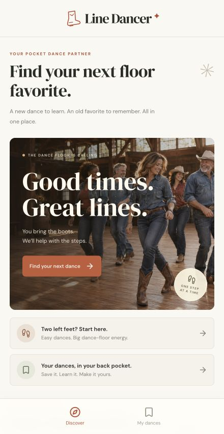

# Line Dancer

## Open the app

**[Launch Line Dancer on your phone or computer](https://line-dancer-jb.burlingamejosh.chatgpt.site)**

Open the link in your browser. No download, account, or terminal commands are required. On iPhone, open it in Safari, tap **Share**, then **Add to Home Screen** for quick access. Your saved dances, ratings, and notes stay in the browser on the device you use.

**Good times. Great lines.** A simple, mobile-first app for keeping track of the line dances you know and finding your next dance-floor favorite.



## What it does

- Discover curated dances, from Copperhead Road to Texas Hold ’Em.
- Search by dance, song, artist, or choreographer; filter by difficulty and sort your results.
- Save dances to your collection and mark them **Want to learn**, **Learning**, or **I know it**.
- Watch a tutorial in each dance’s lesson tab or open it on YouTube.
- View the choreographer’s original PDF step sheet and print it from your browser.
- Record your own difficulty rating and practice notes, with a small glossary for unfamiliar steps.

## Developer setup

Requires **Node.js 22.13.0 or newer** and npm.

```sh
npm ci
npm run dev
```

Open [localhost:5173](http://localhost:5173). To choose another development port:

```sh
npm run dev -- --port 3000
```

Build and preview the production Worker locally:

```sh
npm run build
npm start
```

Use the loopback URL printed by Wrangler. `npm start` previews the built app; it does not deploy it. No API keys or database setup are required for the current features.

## Your collection

Saved dances, progress, ratings, and notes live in your browser’s `localStorage`. They persist on the same browser and device, with no account or cross-device sync. Clearing browser storage removes the collection. If storage is unavailable, changes last only for the current session.

Discovery is a curated catalog, not a live trending feed. Tutorial playback and external step sheets require an internet connection. Beginner filters include Absolute Beginner and High Beginner dances; each dance’s notes preserve the published level and relevant tag or restart reminders.

## Stack and project files

Built with **React 19, TypeScript, Vinext, Vite, and Cloudflare Workers**, with Lucide icons and custom responsive CSS.

- `app/page.tsx` — discovery, collection, dance details, and local progress storage.
- `app/globals.css` — responsive layouts, colors, and component styles.
- `app/layout.tsx` — page metadata and application layout.
- `lib/dances.ts` — the credited dance catalog and verified lesson/PDF links.
- `public/images/` — dance photography and the generated hero image.
- `worker/index.ts` and `vite.config.ts` — Worker entrypoint and build configuration.
- `SOURCES.md` — choreography, lesson, and image attribution.

The included `scripts/` support local development and Sites packaging. Generated build output is written to `dist/`; local runtime state is ignored by version control.

## Credits

Choreography and lessons belong to their creators. Full directions open at the original publishers rather than being reproduced in the app. See [SOURCES.md](SOURCES.md) for the specific choreographers, tutorial creators, PDF references, and image sources.
